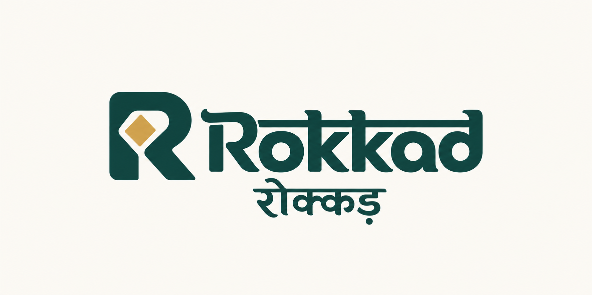

# Rokkad



Rokkad is a shared-schema Django SaaS application for operational pawn lending.
Business performed directly in Rokkad, transactions entered later from paper,
and supported imported positions share a PawnLoan servicing lifecycle and current
risk monitoring. Their original source evidence remains distinct.

The [16 October loans hardening acceptance record](docs/implementation/loans-architecture-hardening-20261016.md)
tracks policy lifecycle, reviewed amendments, active-portfolio readiness and staff
workflows. These changes, represented-position coverage and everyday-counter
improvements are deployed in the [17 October release](docs/implementation/counter-release-20261016.md)
after full CI, isolated production-copy acceptance and verified recovery.

Business apps are **Party, Loans, Rates and Notify v2**. Loans owns financial and
custody evidence; Rokkad is not a general-ledger or general-purpose ERP system.
Workspace rows have direct ownership and PostgreSQL forced row-level security
under a restricted runtime database role.

Start with [documentation](docs/README.md), [Status](docs/STATUS.md),
[agent memory](docs/AGENT_MEMORY.md) and the [constitution](docs/constitution.md).

## Product coverage

| Area | Supported capabilities |
|---|---|
| Workspace | Explicit resolution, ownership/membership, roles, invitations, lifecycle, subscriptions and entitlements |
| Customers | Party identities, contacts/addresses, private files and borrower relationships |
| Loan recording | Shared entry/review, direct or earlier completed paper payout, standing terms, numbering, multiple collateral items and frozen agreements |
| Servicing | Supported receipts/partial payments, interest recognition, settlement/release, renewals, auctions and compensating corrections/reversals |
| Collateral | Appraisals, custody/storage, funding relationships, physical verification, identification and labels |
| Documents | Configurable layouts/print profiles, frozen issued artifacts and exact reprints |
| Rates | Workspace metal quotes, effective dates and supported corrections/withdrawals |
| Monitoring | Debt/DPD/maturity, independent current valuation, LTV/headroom/shortfall, evidence completeness, recurring assessments and staff alerts |
| Communication | Loans-owned notice intent, authorized borrower workflows and Notify v2 delivery evidence |
| Khata | Loans-owned account/custody, collections and settlement with separate cover/overdue rules outside ordinary PawnLoan assessment |
| Portability | Supported active/opening and closed-position admissions, provenance and bounded export/restore contracts; unavailable earlier history is not fabricated |

Each action retains its contract, authority and source/custody prerequisites.
Not every operation supports every legacy graph. An accepted closed position can
be an ordinary browsable CLOSED loan without invented original payout/receipt history.

## Current status and limits

As of **17 October 2026**, production runs the counter/monitoring release
`1889e488`, runtime V13, Loans 0091 and portability 0030/package 4. Shared
origination/corrections, represented-position servicing, current valuation policy
and counter improvements passed full CI and isolated recovery/rehearsal gates.
See the [release record](docs/implementation/counter-release-20261016.md) for exact
identities and supported profile/graph limits. [Status](docs/STATUS.md) is the
current delivery authority; older local-only notes remain historical evidence.

Repository hygiene is being implemented under
[FW-024](docs/implementation/repository-hygiene-20261017.md), with full context
snapshots and checksummed reference assets. It changes developer organization,
fixtures and CI safeguards; no production/schema change is part of that work.

Current assessment does not mean healthy, complete paper books or usable collateral.
Monitoring does not post charges, send messages or choose recovery automatically.
Regulatory NPA/provisioning, default prediction, full collections case management,
full captured assessment history and launch-scale acceptance are outside current
coverage. See [future work](docs/plans/future-work.md).

## Monitoring references

- **Owner:** Loan health → **Loan monitoring guide**, also linked from Operations
  console and Financial health. It covers metrics, examples, methods, paper books
  and actions. See Status for the current release boundary.
- **Developer:** [Post-origination monitoring architecture](docs/architecture/post-origination-loan-monitoring.md).
- **Operator:** [Loan health and refresh](docs/flows/loan-health-monitoring.md).
- **Contracts:** [PawnLoan read models](docs/domain/pawn-loan-financial-read-models.md)
  and [interest calculation](docs/implementation/pawn-loan-interest-calculation.md).

## Architecture and repository

- `apps/orgs`, `onboarding`, `subscriptions`, `accounts`: control plane and auth.
- `apps/tenant_apps/party`, `loans`, `rates`, `notify_v2`: business domains.
- `apps/tenant_apps/data_portability`: bounded admission/exchange/restore adapters.
- `apps/tenancy`: transaction-local Workspace context, registry, RLS and checks.
- `django_project/settings`: dev/prod/migration/test/container settings.
- `templates`, `static`: Django/HTMX interface; `docs`: maintained reference.

Completed actions create immutable Loans-owned evidence. Balances derive from
that evidence and accepted openings; corrections use supported compensation or
reversal. Risk snapshots are current derivative projections with protected
transitions. Posting/calculation do not belong in views/templates.

Read [control-plane contracts](docs/architecture/control-plane-contracts.md)
before changing Workspace authority, resolution, lifecycle or integration.
Retired Girvi, DEA, Contact, Product, accounting and legacy Notify dependencies
must not return. See [dependency boundaries](docs/implementation/dependency-policy.md).

## Runtime

Python **3.14**, Django **6.1.1**, PostgreSQL **16** development/CI baseline,
standard Django backend and distinct owner/runtime roles. The UI uses Django
templates, HTMX, Bootstrap/crispy forms and Select2. Docker/Gunicorn/WhiteNoise
serve the app. Production media is private Cloudflare R2; database/runtime recovery
uses separately scoped encrypted off-server artifacts. Optional Redis supports
existing cache uses; risk monitoring needs no Redis queue or cross-request cache.

Install with `requirements.txt` and `requirements.lock` constraints. See
[private media](docs/implementation/private-media-access.md) and
[cache configuration](docs/implementation/cache-configuration.md).

## Local development

Use the [container runbook](docs/implementation/container-and-ci.md) for an isolated
database/media stack. Copy `.env.container.example` to `.env.container`, replace
placeholders and use separate owner/runtime passwords. Do not use production or
existing business data for experiments.

```sh
docker compose --env-file .env.container config --quiet
docker compose --env-file .env.container build
docker compose --env-file .env.container up -d db
# First initialization only: provision a NEW restricted runtime role.
docker compose --env-file .env.container run --rm migrate python scripts/provision_runtime_role.py
docker compose --env-file .env.container run --rm migrate
docker compose --env-file .env.container up -d web
```

Open `http://localhost:8000`. `docker compose --env-file .env.container down`
stops the stack while retaining named volumes.

For host development, create and activate a Python 3.14 virtual environment:

```sh
python -m venv .venv
# Activate .venv using your shell's command.
python -m pip install -r requirements.txt -c requirements.lock
python -m pip check
```

`manage.py` defaults to `django_project.settings.dev`. Configure `.env` using the
[PostgreSQL role guide](docs/implementation/postgresql-runtime-role.md). Web and
worker must never use owner-only migration settings.

```sh
python manage.py migrate --settings django_project.settings.migration --noinput
python manage.py check --database default
python manage.py runserver
```

Read [business setup](docs/flows/business-setup.md), [loan journey](docs/flows/loan-journey.md)
and [testing/migrations](docs/implementation/testing-and-migrations.md).

## Verification and contributions

Follow [AGENTS.md](AGENTS.md) and [CONTRIBUTING.md](CONTRIBUTING.md). Update Status
and relevant guidance with meaningful changes. Prefer the smallest coherent
Django implementation preserving evidence, authority and Workspace isolation.

```sh
python scripts/check_current_docs.py
python scripts/check_app_boundaries.py
python manage.py makemigrations --settings django_project.settings.test --check --dry-run
python manage.py test apps.tenant_apps.loans.tests --settings django_project.settings.test --noinput
```

Tests create/drop a disposable database. Adversarial RLS DML uses restricted
`NOSUPERUSER NOBYPASSRLS`. Never run suites concurrently against one test database
or point tests at normal development data.

CI is [workspace-checks.yml](.github/workflows/workspace-checks.yml): documentation,
imports, migrations, runtime-role startup, control-plane/business regressions and
container smoke checks. See [CI details](docs/implementation/container-and-ci.md).

## License

See [LICENSE](LICENSE) for repository and dependency notices.

