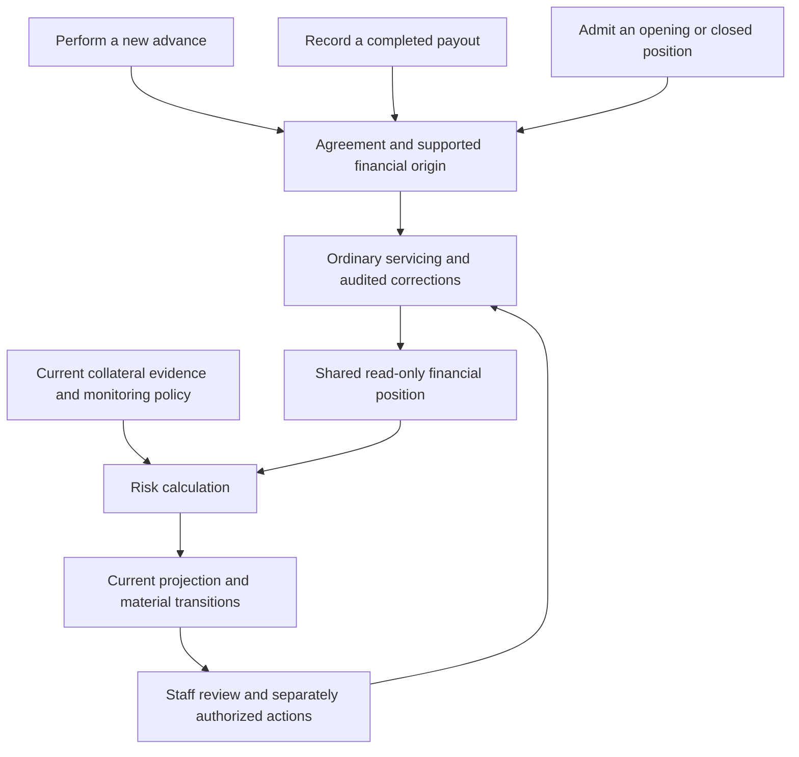

# Simplifying origination and risk monitoring

## Scope and conclusion

This is a source review and proposed direction requested by the owner on
16 October. It does not approve implementation or a production rollout. No
application code, database, loan, policy or deployment was changed for this review.
No production queries or new runtime benchmarks were performed. The checkout
contains ongoing, uncommitted collateral and financial correction work; those
changes must remain separate from deployed capabilities.

Keep one PawnLoan domain within the existing Django application. Origination
establishes the agreement and supported starting position. Servicing records
financial and custody changes. Monitoring reads their results with current
evidence and monitoring policy. Its derived results must not become authority
over the original agreement, manufacture historical transactions, or originate
financial entries.

The core architecture is usable. Most remaining complexity is at orchestration,
compatibility and evidence boundaries. A new service platform, second ledger or
new loan class for each entry source would increase that complexity.

## Delivered foundation to preserve

- One ordinary loan identity, borrower, collateral register, lifecycle and
  Workspace isolation across direct, paper and supported imports.
- Shared modern monthly anniversary and frozen rounding semantics. Origin
  provenance does not justify a different borrower interest contract.
- Accepted opening and closed positions without fabricated earlier history.
- Shared servicing-contract, continuation, exposure and delinquency readers.
- Independently configurable current monitoring valuation and thresholds.
- A pure risk classifier, shared live/saved calculations, current saved
  projections, source checks, recurring refresh and internal risk transitions.
- Book completeness distinct from valuation and assessment freshness, including
  the optional reviewed transition to future Rokkad-only capture.

The current [monitoring guide](post-origination-loan-monitoring.md) describes the
implemented pipeline. The [origination consolidation decision](../adr/2026-10-14-origination-consolidation.md)
and [financial correction plan](../plans/shared-agreement-financial-corrections-20261015.md)
must be respected; this review does not replace them or claim pending corrections
have already been deployed.

## Proposed responsibility boundaries

This is a responsibility diagram, not a proposal for new services or tables.
Monitoring has a legitimate read dependency on the loan and its obligations.
Decoupling means that the source of entry does not choose a different economic
meaning, and the risk calculator does not control financial posting.

## 1. Make action purpose explicit at origination

[completed_payout_adapter](../../apps/tenant_apps/loans/services/completed_payouts.py)
selects retained-native or recorded admission based on existing approval,
events and snapshots. The [web action](../../apps/tenant_apps/loans/web/workflow.py)
then selects different review paths. Consequently a staff intention to record
money already paid can encounter a historical approval-evidence requirement.

The [historical quote reader](../../apps/tenant_apps/loans/services/historical_origination.py)
requires a quote effective on the actual loan date, still current in its
correction chain, with retained bytes matching the old approval. This differs
from ordinary approval's configurable quote-age allowance. A valid earlier
approval using an allowed prior-day quote can therefore encounter a stricter
later recording path. This is a source finding, not a diagnosis of the particular
quote rejected in the recent missed-payout recovery.

Use three explicit purposes with small concrete handlers:

| Purpose | Necessary checks | What it establishes |
|---|---|---|
| Perform a new advance | Current authorization, applicable economic/valuation rules, quote eligibility and any required approval | A lending decision and actual payout |
| Record a completed payout | Actual date, identity, agreed item economics, deductions/net cash, duplication, authority and supported source facts | A fact that occurred earlier; any genuine approval is retained evidence |
| Admit a known position | Identity, supported as-of principal/interest or verified zero position, custody and continuation requirements | A supported starting point, with explicit unavailable earlier history |

Correcting an already recorded fact remains an audited correction action.
Money not yet paid remains an unpaid draft/approval; it must not be activated
simply because staff select completed recording.

Use one familiar loan editor and review summary. Entry purpose selects the
relevant checks. Genuine prior approval can be displayed alongside the completed
facts without forcing staff to obtain retrospective approval. Inconsistent prior
evidence must remain visible and require explicit review; do not silently retry
another adapter or overwrite the original decision. Reuse shared identity,
numbering, item allocation, agreement freezing and idempotency checks at commit.

Approval and payout remain different facts even where an authorized staff member
completes them in one action. Separating their records need not require separate
screens or artificial waiting states.

## 2. Formalize the existing shared financial read boundary

[ServicingContract](../../apps/tenant_apps/loans/selectors/servicing_contract.py),
[continuation](../../apps/tenant_apps/loans/selectors/continuation.py) and
[exposure](../../apps/tenant_apps/loans/selectors/exposure.py) already normalize
different persisted origins. Modern native periods, recorded cumulative
recognition, opening checkpoints and older event folds retain different evidence
formats. These are compatibility responsibilities, not separate loan products.

Monitoring currently reuses private prepared financial inputs. Promote the small
existing shared reader and immutable result contract to a supported internal
boundary. It should expose the agreed calculation semantics, supported history
start, principal, recognized/projected interest, obligations and source/integrity
references needed by its consumers. Preserve the distinction between recorded
debt and unrecognized economic estimates.

Keep legacy decoding inside continuation/read adapters. New risk, documents and
dashboard code should not inspect origination payloads to choose interest rules.
Do not add another authoritative balance table or rewrite historical events to
make old evidence look modern. Calculators used by these readers must remain
read-only even where their implementation currently lives in preview services.

## 3. Separate agreement, original decision and current monitoring semantics

The current [collateral valuation reader](../../apps/tenant_apps/loans/selectors/collateral_valuation.py)
requires a frozen disbursal policy even when an independent current valuation
method was selected. It reads the original method, currency quantum and maximum
LTV from that snapshot. Current monitoring policy is already independent, but
this is a residual semantic dependency on an origination-shaped record.

Resolve three explicit meanings, initially through ordinary functions and result
objects over existing storage:

1. **Agreed financial terms:** interest, tenure, allocation and rounding used for
   servicing. Retain immutable originals and audited correction revisions.
2. **Original decision evidence:** any genuine quote, appraisal, approval and
   lending limit. Its absence on an imported/paper loan is not a requirement to
   invent such evidence.
3. **Current monitoring basis:** today's valuation method, usable prices or
   appraisals, freshness, eligible custody and attention thresholds.

Keep the existing preserve-original-method option and compatibility readers.
Current appraisal-only, calculated-metal and lower-of-both options already exist;
this proposal is to remove residual coupling, not rebuild those features.

Treat the saved origination maximum LTV and current monitoring thresholds as
different concepts. Current valuation uses the former for allowed-advance/headroom
calculation while risk classification uses current policy thresholds. Explain
which applies. Do not silently change the formula or borrower's terms during a
refactor. Independent monitoring precision, if introduced, must preserve the
current numerical result by default and be versioned when changed.

Missing interest terms can limit future servicing and total-exposure precision
without making known principal, custody or other supported observations disappear.
Verified closed loans remain ordinary closed positions outside the active risk
portfolio; they need no fictional original approval for that purpose.

## 4. Make evidence time explicit

Current valuation passes a calendar date into the
[Rates facade](../../apps/tenant_apps/rates/facade.py). That facade applies a
date-level cutoff for a date argument and a timestamp cutoff for a datetime.
Appraisal selection also uses an effective-date filter. The freshness helper
compares calendar dates. These predicates can select an otherwise eligible quote
or approved appraisal effective later on the same day for a live assessment.

This is a static correctness risk requiring a characterization test; it is not
evidence of an observed production misvaluation. First test later-today quotes
and appraisals, then use an explicit assessment instant for live evidence
eligibility. Keep the business date for anniversary, overdue and age-day rules.
Define the cutoff for dated reports separately. A dated restatement of currently
available knowledge is different from proof of what staff knew at that time.

Preserve original loan date, financial event occurrence date, entry timestamp and
assessment instant. One generic date cannot represent all four.

## 5. Keep risk calculation, persistence and operational response distinct

The [risk classifier](../../apps/tenant_apps/loans/domain/risk.py) is already a
pure function. The [snapshot service](../../apps/tenant_apps/loans/services/risk_snapshots.py)
assembles sources, checks fingerprints, calculates, persists and records material
transitions. Retain that useful separation and keep notifications/recovery under
their own authority.

Make result dimensions consistently explicit: economic risk, valuation usability,
book completeness and assessment freshness. Missing valuation currently produces
HIGH priority through VALUATION_UNKNOWN. That is a valid reason to investigate,
but it is not proof of an LTV breach. Preserve an operational priority while
showing whether its cause is measured risk or unavailable evidence. Unknown must
never be presented as healthy or clear a previously established breach.

The dashboard should continue reading current projections. A loan detail may use
the same calculator for a live preview. Neither read should post interest. The
current snapshot is a replaceable projection; material transition events are not
a complete historical assessment archive. Do not promise the latter without
explicit retention requirements.

## 6. Reduce operational coupling only with equivalent freshness guarantees

[Risk signals](../../apps/tenant_apps/loans/risk_signals.py) invalidate saved
projections inside source transactions. This reliably prevents stale results
remaining current, but financial writes also depend on an update to a derivative
monitoring table. Bulk updates need explicit coverage because they bypass
post-save signals. This is a structural coupling, not an observed failure.

First make the source-change contract explicit and test every relevant mutation.
Do not simply move invalidation to on-commit callbacks or swallow failures: a
crash can otherwise leave an obsolete healthy result marked current. Keep
transactional invalidation until a replacement has equivalent guarantees.

If measurement justifies a further change, source-owned revisions can be bumped
atomically and compared with the revision captured by each assessment. This can
decouple financial commits from derivative-row availability. Rate/policy scope,
date rollover, corrections and concurrent changes must also participate. Reuse
existing version identities where possible; avoid a generic event platform.

The [worker](../../apps/tenant_apps/loans/services/risk_jobs.py) deliberately holds
a loan-row claim through calculation and projection writes, with skip-locked
selection and bounded per-loan transactions. This protects competing workers but
can serialize servicing on the same loan. Measure lock waits and calculation
duration before changing it. If needed, compute from versioned inputs, then take
a short commit lock and recheck sources, state and date with bounded retries.
Do not remove locks/fingerprint checks without proving equivalent consistency.

## 7. Keep capture expectations independent of origination provenance

[Transaction completeness](../../apps/tenant_apps/loans/selectors/transaction_completeness.py)
already retains reviewed paper coverage and an explicit future Rokkad-only choice.
However, default review requirements are inferred partly from recorded origins,
opening events and later recording markers.

Make the continuing capture expectation explicit in the existing review/admission
boundary: ordinary Rokkad capture, continuing paper reconciliation, or reviewed
transition to Rokkad-only. A historical origin does not by itself determine future
practice. Preserve accepted history boundaries and do not demand reconstruction
before them. Late recording can legitimately require a renewed book check; it
must not permanently change the borrower's economic contract.

## Recommended implementation order

1. Establish characterization cases and map deployed versus pending correction
   readers. Resolve the intraday evidence cutoff as a focused correctness change.
2. Consolidate completed-payout purpose and review, preserving actual terms,
   retained decision evidence, numbering and successful-retry semantics.
3. Promote the existing shared financial read contract; move consumer branching
   behind compatibility readers without rewriting money history.
4. Separate current monitoring inputs from original decision requirements, keeping
   existing methods, formula meanings and default numerical parity.
5. Make risk/quality/freshness output and capture expectations consistent across
   loan detail, staff work queues and portfolio summaries.
6. Measure invalidation cost and worker contention; change revision/locking
   mechanics only if a measured problem warrants the additional machinery.

Complete and coordinate the current financial correction programme rather than
create a competing correction engine. Changes to portable meanings, profiles or
persisted calculations require compatible export/restore readers and controlled
release sequencing.

## Acceptance criteria

- For equal supported agreements, events, collateral, custody, assessment time and
  current policy, entry source does not change debt or economic risk. Book
  completeness and unavailable earlier history may legitimately differ.
- Direct, paper, missed payout, reviewed opening and verified closed admissions
  preserve identity, one financial origin, retry safety and Workspace isolation.
- Original-anniversary boundaries, frozen rounding, partial principal reductions
  and different-rate item allocations retain existing correct results.
- Monitoring and dated previews write no financial entries. Missing price or
  appraisal cannot manufacture value, reapprove a loan or prevent recording a
  genuine receipt solely because risk coverage is unavailable. Genuine financial,
  custody and authorization constraints still govern servicing actions.
- Concurrent source changes, future intraday evidence, withdrawn/corrected quotes,
  day rollover, worker failure and bulk update paths cannot yield a falsely
  current or falsely healthy result.
- Original decision records, old documents, correction lineage and known history
  boundaries survive compatible portable export/restore.

These are proposed gates, not newly executed test results. The aim is fewer
origin-specific decisions in ordinary code while preserving truthful financial
history and actionable monitoring.
