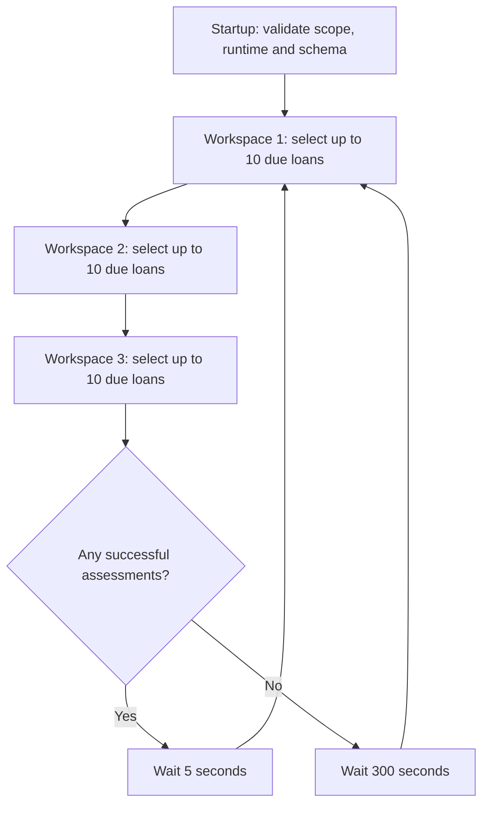

# Monitoring worker: lifecycle, refresh rules and scaling

Owner and developer reference for the implemented worker, documented at the
owner's request after the combined Loans release. Current behaviour and possible
improvements are deliberately identified separately. This review authorizes no
new scheduler, production policy change or resumption of the shelved capacity test.

## What runs today

One continuous Docker monitoring process serves the three explicitly assigned
Workspaces. It runs without a browser session and is separate from the six host
timers for mail, storage and backups. The application and monitoring worker use
compatible source and the restricted PostgreSQL runtime role.

Production metadata checked on 16 October 2026:

| Setting | Observed configuration |
|---|---|
| Assigned Workspaces | JCL, JSK and Lakshmi; explicit IDs 1, 2, 3 |
| Candidate limit per Workspace turn | 10 |
| Pause after a round with any successful assessment | 5 seconds |
| Pause after a round without successful assessments | 300 seconds |
| CPU limit | 0.35 CPU core |
| Memory limit | 512 MiB |
| PID limit | 128 |
| Restart policy | Docker `unless-stopped` |

At that inspection the worker was running with zero restarts. The latest ten-loan
turns took 2.856/3.499/2.078 seconds for the three Workspaces. These are samples,
not a throughput guarantee. Successful refresh counts are operations, not unique
loans: a later source change can make the same loan due again.

The startup wrapper is [start_monitoring.py](../../scripts/start_monitoring.py).
It validates explicit positive Workspace IDs and bounded settings, runs the
ordinary runtime/schema checks, then replaces itself with the unbuffered Django
management command. Its environment settings are `ROKKAD_MONITOR_WORKSPACE_IDS`
(or the older singular setting), `ROKKAD_MONITOR_BATCH_SIZE`,
`ROKKAD_MONITOR_BUSY_SECONDS`, and `ROKKAD_MONITOR_REPEAT_SECONDS`.

The command supports batches 1-1,000, busy pauses 1-60 seconds and repeated idle
pauses 60-86,400 seconds. Command defaults and wrapper defaults differ; use the
actual deployed wrapper configuration when describing production. A zero command
repeat interval selects one-shot mode: one turn per supplied Workspace, then exit.
The repeating production wrapper always supplies a supported positive interval.

## A round and a transaction

Each selected candidate gets a separate transaction and Workspace context. The
worker checks operational/business-write access, rechecks ACTIVE state and
currentness, claims the loan using `SELECT FOR UPDATE SKIP LOCKED`, calculates,
verifies source applicability, writes the snapshot/material transitions/alerts,
then commits before proceeding to another loan. The claim stays held throughout
calculation and commit. Selection before that claim is advisory; a closed,
already-refreshed or locked candidate can be skipped.

There is no surrounding portfolio transaction, external job queue, Redis claim,
or persistent lease. Earlier successful loan commits survive a later failure.
Each Workspace gets a bounded turn in supplied order, rather than waiting for
the previous Workspace's whole portfolio to finish. Workspace access is checked
again for each loan; suspension/read-only business access can prevent refreshes.

Round duration is the sum of the Workspace turns plus the applicable pause. A
five-second busy pause is neither a five-second assessment interval for each
loan nor an upper bound on waiting time. A ten-candidate limit bounds work count,
not wall-clock duration or the cost of reconstructing one long loan history.

## What is due

A saved assessment is current only if its status is CURRENT, its reporting date
is today locally, its calculation contract is current (V11 at this release), and
any recorded scheduled-evidence deadline has not been reached. Due candidates
are ACTIVE loans not satisfying that predicate, ordered by oldest snapshot update
time, with missing snapshots first. Selection is not ordered by risk severity.

| Trigger | Current effect |
|---|---|
| New active loan without a snapshot | Eligible as unassessed |
| Receipt, reversal, obligations, schedule or loan change | Atomic per-loan invalidation |
| Collateral/appraisal/custody change | Per-loan invalidation; supported bulk corrections invalidate explicitly |
| Applicable metal price change | Invalidate affected Workspace/metal/date scope |
| Monitoring policy amendment | Invalidate affected Workspace/licence/assessment-date scope |
| Transaction review or recording-practice change | Explicit per-loan invalidation |
| New local calendar day | Yesterday's snapshots fail currentness without needing a source save |
| Previously scheduled evidence becomes applicable | Reached evidence deadline makes the result due |
| New calculation contract | Older-version results fail currentness |
| Failed assessment | Remains due for another attempt |

Source mutation marks results outdated inside its transaction; it does not run
the full portfolio calculation. The polling worker discovers committed work on
its next turn. A change during an idle pause can wait up to the next poll, plus
queue/processing time. Broad invalidation still updates many rows and has a cost.

**Both descriptions are true:** the worker selectively processes outdated loans,
and the current today-only rule makes essentially every continuing active loan
outdated on a new day. It does not recalculate already-current loans every five
minutes. If JCL has caught up while another Workspace is busy, JCL can have empty
turns without re-running its full loan calculations.

## Reads, writes and evidence

One assessment reads the supported loan continuation and obligations, calculates
exposure/DPD/maturity, values collateral using stored evidence/current monitoring
policy, evaluates recording coverage, and classifies risk. Prepared financial
inputs are reused inside that calculation; there is no equivalent persistent
cross-day component cache. Source fingerprints and final date/evidence-deadline
checks prevent publishing a result against incompatible inputs.

The worker writes the latest derivative snapshot and material immutable risk
transitions/internal alerts. It does not store an entire new historical assessment
archive for every run. Unchanged refreshes do not create another identical risk
incident. Missing/failed evidence cannot clear an earlier known risk as healthy.

It does not pay/collect money, recognize interest into the financial records,
rewrite an agreement, obtain external market quotes, inspect jewellery, certify
unentered paper transactions or send borrower messages. Financial posting and
borrower communication remain separate authorized operations.

An unavailable appraisal can produce a successful CURRENT assessment with UNKNOWN
coverage. It is not automatically an ERROR, and is not repeatedly retried within
today merely because coverage is incomplete. New evidence/source changes, a
deadline, a new day or explicit refresh can cause another calculation.

## Failures, stop and restart

Calculation failures are recorded as ERROR where possible; unusable amounts are
not presented as healthy. Other candidates/Workspaces can continue. Error rows
remain due. A round with no successful assessments waits 300 seconds; if other
loans succeed, failed loans may be retried on busy rounds. There is no separate
per-loan exponential retry delay or durable dead-letter queue.

SIGTERM unwinds the active transaction and stops the command cleanly. An abrupt
crash rolls back uncommitted database work. On restart, due selection discovers
unfinished work; successfully committed current loans are skipped. Docker
`unless-stopped` restarts exited processes unless intentionally stopped. This
does not by itself detect every hung query, excessive backlog or freshness breach.

The claim can briefly delay servicing of the same loan. Other loans normally
continue independently. Broad invalidation and other database locks can cause
wider contention. Invalidation remains transactionally coupled to source writes;
a missing monitoring table is a storage failure, distinct from a missing appraisal.
LS-06 fixes a reproduced policy-parent lock cycle, not every possible deadlock.

## Dashboard behaviour and V11 catch-up

The dashboard aggregates usable saved snapshots; it does not initiate worker
calculations. Its current frontend lazy-loads sections and has no periodic health
polling timer or push subscription. Reloading/loading a section observes newer
commits. Apparent changes on a completely untouched page need a separate UI trace.

A version deployment excludes older-contract results until refreshed. Financial
totals can rise as more loans enter the usable subset, without new lending. The
denominators/completeness counts explain that change. V11 identifies derived
calculation semantics, not a new borrower contract or deletion of loan history.

Freshness, financial calculation, valuation evidence and transaction coverage are
independent. A current balance cannot supply a missing appraisal or certify that
staff entered every paper receipt. See the dated
[JCL coverage review](../implementation/jcl-monitoring-coverage-review-20261016.md).

## Scaling assessment

The current design provides bounded fairness, isolated commits and recovery,
restricted-tenant execution and safe competing claims. It is a useful correctness
baseline. It is not proof of launch-scale capacity or absence of contention.

Its present limits include serial processing within a worker, expensive history
reads, daily whole-portfolio expiry, broad price/policy invalidation, a shared
database and explicit Workspace assignment. Overlapping workers can select the
same initial candidate window before skip-locked rechecks; more identical workers
do not imply proportional throughput. New Workspaces are not automatically
assigned just because someone signs up.

The earlier 300,000-loan test processed 121,869 assessments in 3,589.09 seconds
and failed its one-hour target. The larger programme remains shelved; this review
does not resume it. Local LS-06 samples around 106 ms per small loan and about
4.2 seconds to invalidate 2,500 rows are not production sizing guarantees. See
[capacity evidence](../implementation/monitoring-capacity-test.md),
[LS-06 measurements](../implementation/loan-boundary-ls06-20261016.md) and
[FW-004](../plans/future-work.md#fw-004-launch-scale-loan-monitoring-capacity).

## Proposed simpler scaling direction (not implemented)

The later locally implemented [represented-position coverage treatment](../implementation/represented-position-coverage-20261016.md)
uses snapshot V13 and separates optional book assurance from usable positions.
It requires coordinated deployment and changes no worker scheduling, resource limit,
daily currentness or capacity acceptance described here.

Prefer a **small bounded worker pool with fair assigned Workspace turns**, plus
more selective scheduled work, over a permanent process for every Workspace.
Separate processes can reduce head-of-line waiting, but do not reduce total work
and share the same database. A process per Workspace can be a small deployment
choice; it is not the default scalable SaaS architecture. Resource limits are
caps, not fixed allocations, but many Django processes still have real overhead.

Recommended order for a future authorized improvement:

1. Keep existing correctness guards. Measure pending count/oldest due age,
   throughput and per-loan/turn duration alongside payment latency and DB pressure.
   Distinguish successful UNKNOWN coverage from actual calculation failures.
2. Partition explicitly authorized Workspace assignments across a small measured
   pool. Preserve fair turns, restricted RLS, compatible readers and total resource
   budgets; do not introduce implicit cross-tenant enumeration or authority.
3. Design indexed per-loan dirty/due-time metadata and error retry timing using
   ordinary PostgreSQL/Django. Source changes still invalidate atomically; retries
   must not hot-loop. Include safe reconciliation for missed scheduling work.
4. Separate reusable source-dependent calculations from cheap date-dependent
   presentation/threshold evaluation. Schedule full work at actual financial,
   obligation, maturity/DPD threshold, quote/appraisal applicability or expiry,
   recording-review, policy and calculation-version boundaries. Unsupported
   profiles retain conservative daily full refresh as a fallback.
5. Prove monetary/risk parity, late-source races, clocks, alerts, concurrent
   servicing and isolation before revising snapshot currentness. Measure on
   representative hardware before claiming a freshness/throughput target.

Daily information still needs to be correct. DPD, maturity distance, daily-interest
contracts, review currency and evidence ages can change without a receipt or new
quote. Reuse must bind exact source/contract lineage; derived monitoring caches
must never become posting authority. Do not simply remove today's date check,
extend a stale result's timestamp, stop daily checks or ignore source changes.
This direction requires an explicit currentness contract/ADR and compatible-reader
release, not merely another container or a changed sleep interval.

Shared rate/policy revisions could later reduce broad invalidation, but require
proof that every consumer rejects old revisions and that late source changes
cannot publish healthy results. The unsuccessful LS-06 CURRENT-only update trial
is not such a proof. Retain existing fan-out until a measured replacement preserves
its source-change and race guarantees. No Celery/Redis/platform rewrite is implied.

## Implementation references

- [Management command](../../apps/tenant_apps/loans/management/commands/reassess_pawn_loans.py)
- [Per-loan worker turns](../../apps/tenant_apps/loans/services/risk_jobs.py)
- [Calculation/persistence and pending selection](../../apps/tenant_apps/loans/services/risk_snapshots.py)
- [Shared currentness predicate](../../apps/tenant_apps/loans/selectors/risk_portfolio.py)
- [Atomic source invalidation](../../apps/tenant_apps/loans/risk_signals.py)
- [Dashboard usability and counts](../../apps/tenant_apps/loans/selectors/dashboard_health.py)
- [Worker transaction decision](../adr/2026-09-11-monitoring-worker-turns.md)
- [Production release proof](../implementation/loan-boundary-release-20261016.deployment.json)
