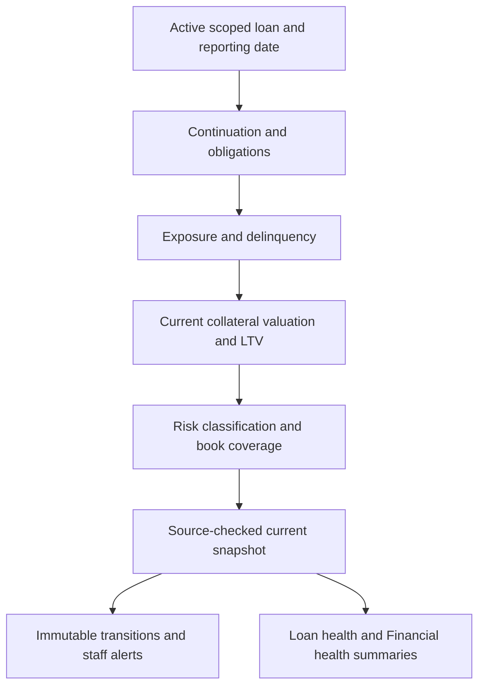

# Post-origination loan risk monitoring

Developer reference for implemented ordinary PawnLoan monitoring, including
MR-02–07. The owner reference is the in-app **Loan monitoring guide**, linked from
Loan health, Operations console and dashboard Financial health after its release.
Its content is [risk_guide.html](../../templates/loans/setup/risk_guide.html).
Operational instructions remain in [Loan health](../flows/loan-health-monitoring.md).

## Purpose and boundaries

Origination establishes an actual agreement and supported starting position.
Monitoring repeatedly checks debt, contractual repayment performance, eligible
collateral cover and the evidence supporting those conclusions. Direct, recorded
paper and imported active loans share this pipeline; continuation adapters supply
different starting evidence, not separate paper risk engines. Earlier unavailable
history remains unavailable. Accepted closed positions remain browsable outside
the ACTIVE portfolio. Khata uses its own cover/overdue rules, not this worker.

Monitoring writes derivative snapshots, immutable risk transitions and internal
alerts. It does not originate debt, finalize interest, rewrite frozen terms,
fabricate quotes/appraisals, initiate recovery or send borrower messages.
Servicing/communication keep their independent authority and posting boundaries.

## Agreement, monitoring policy and source evidence

- Frozen agreement/product determines repayment structure, interest, actual terms
  and saved maximum LTV. Later setup changes do not rewrite existing debt.
- Effective-dated monitoring policy determines current valuation, maturity/DPD/LTV
  attention thresholds, freshness and eligible custody. Resolution prefers a
  complete licence override, otherwise the Workspace default; it is not a
  field-by-field merge. Amendments retain predecessor, author and reason.
- Actual events/allocations, schedules, collateral/custody, Rates quotes, approved
  appraisals and book review supply evidence. Configuration cannot replace facts.

Preserving a saved valuation method does not freeze its original rupee value.
For paper/imported loans, an admitted monitoring method need not prove original
lending valuation. Changing current monitoring must not rewrite original economics.

## Pipeline and source map



| Responsibility | Source / entry point |
|---|---|
| Resolve contract, recorded position and recognition preview | [continuation.py](../../apps/tenant_apps/loans/selectors/continuation.py), `resolve_loan_continuation` |
| Fold schedule/dated allocations | [obligation_state.py](../../apps/tenant_apps/loans/selectors/obligation_state.py), `calculate_obligation_state_as_of` |
| Financial exposure and integrity findings | [exposure.py](../../apps/tenant_apps/loans/selectors/exposure.py), `get_pawn_loan_exposure` |
| Contractual DPD/grace | [delinquency selector](../../apps/tenant_apps/loans/selectors/delinquency.py), [calculator](../../apps/tenant_apps/loans/domain/delinquency.py) |
| Effective monitoring policy | [monitoring_policy.py](../../apps/tenant_apps/loans/selectors/monitoring_policy.py) |
| Per-item value and evidence | [collateral_valuation.py](../../apps/tenant_apps/loans/selectors/collateral_valuation.py) |
| LTV/headroom/shortfall | [ltv.py](../../apps/tenant_apps/loans/domain/ltv.py) |
| Classification/action hint | [risk selector](../../apps/tenant_apps/loans/selectors/risk.py), [domain](../../apps/tenant_apps/loans/domain/risk.py) |
| Independent transaction coverage | [transaction_completeness.py](../../apps/tenant_apps/loans/selectors/transaction_completeness.py) |
| Today-only persistence | [risk_snapshots.py](../../apps/tenant_apps/loans/services/risk_snapshots.py) |
| Transitions and incidents | [risk_transitions.py](../../apps/tenant_apps/loans/domain/risk_transitions.py), [risk_alerts.py](../../apps/tenant_apps/loans/services/risk_alerts.py) |
| Bounded worker | [risk_jobs.py](../../apps/tenant_apps/loans/services/risk_jobs.py) |
| Source invalidation | [risk_signals.py](../../apps/tenant_apps/loans/risk_signals.py) |
| Projection summaries | [risk_portfolio.py](../../apps/tenant_apps/loans/selectors/risk_portfolio.py), [dashboard_health.py](../../apps/tenant_apps/loans/selectors/dashboard_health.py) |

MR-07 reuses one private loan/date/Workspace-checked financial input set within a
composed refresh. Book coverage is computed once after financial/valuation reads.
Appraisals use one per-loan query; each metal quote is read once per call.
Standalone selectors still work independently. There is no cross-request cache
or financial-result change. See [MR-07](../implementation/monitoring-efficiency-mr07.md).

## Amounts, due dates and performance

With recorded outstanding principal P, interest I, fees F and additional eligible
unrecorded interest through the reporting date U:

| Metric | Implemented meaning |
|---|---|
| Recorded total due | P + I + F; a recorded balance, not schedule-derived due-now |
| Economic exposure | P + I + F + U |
| Estimated unfinalized interest | U, distinct from I and from collected cash/realized profit |
| Due now | Unpaid contractual obligations due on/before the reporting date |
| Overdue | Unpaid contractual obligations due before that date |
| Maturity payoff | Remaining scheduled principal/interest plus recorded outstanding fees |
| Coverage exposure | Maturity payoff for single-payment bullet, periodic-interest bullet and flexible partial-payment; economic exposure for amortizing structures |
| DPD | Days since the oldest unpaid overdue due date; zero if none |
| Days to maturity | Contractual maturity minus reporting date |

Dated receipts/reversals and allocations determine remaining obligations. A
partial payment does not reset DPD while the oldest obligation remains unpaid.
Interest eligibility, recognition and payment due dates are separate. The shared
anniversary contract (5 April/upfront first month → next charge on 6 May) does not
by itself create monthly instalment obligations on flexible loans.

Integrity checks reject negative debt/projections, unsettled positions without
supported schedules, principal mismatch and inconsistent recorded component totals.
ERROR clears unsafe current money/DPD/LTV and retains diagnostics. Book failure
after supported exposure must not mislabel the financial calculation unsupported.

**Grace integration limit:** frozen product/opening terms supply grace.
`calculate_delinquency` returns `escalation_eligible` when the date is after oldest
due date plus grace, without shifting DPD. Current classification/alert code does
not consume it as a suppression gate. Do not promise grace-delayed alerts.

## Valuation, freshness and custody

The selector reads the latest APPROVED appraisal effective on/before the date,
ordered by effective time then version. Rates comes through its existing facade.

Calculated value supports GOLD, SILVER and BRONZE. The buying quote is INR per
gram at a 100% reference grade: pure gold/silver or the bronze material itself.
No copper/alloy conversion is inferred. The existing `24k` quote key remains
compatible. Normalize the saved currency quantum before quantizing: stored
0.0100 means paise, not four decimal places. V9 corrects that current valuation
precision and adds bronze price invalidation/source checks without rewriting
original lending or financial evidence. See the
[bronze decision](../adr/2026-10-14-bronze-reference-price-valuation.md).

| Method | Required evidence and value |
|---|---|
| CALCULATED_METAL_VALUE | Buying rate × net weight × purity / 100, quantized using saved currency quantum and ROUND_DOWN; usable fresh rate |
| LATEST_APPRAISAL | Latest applicable approved value, with usable fresh appraisal |
| LOWER_OF_CALCULATED_AND_APPRAISAL | Per-item minimum; both sources must be usable |
| ORIGINAL_AGREEMENT policy choice | Resolve the saved method, then apply current evidence/age/custody checks |

Age limits are inclusive local calendar days. Missing, invalid, future,
unconfigured and stale evidence remain distinguishable. Model defaults are seven
days for quotes and 90 for appraisals, not a claim about every live policy.
Appraisal-only does not require an unused metal quote; metal-only does not require
an unused appraisal; lower-of requires both.

Custody must be IN_VAULT or WITH_FUNDING_LENDER and policy-permitted. A required
item blocker makes full loan valuation unknown. Do not sum known items and present
that subset as complete collateral coverage. Refresh does not inspect jewellery
or renew evidence dates. Selected value is not guaranteed net sale proceeds.

With exposure E, eligible value V and the loan's saved maximum LTV A:

```text
LTV = E / V
policy headroom = V × A − E
full shortfall = max(E − V, 0)
```

Missing/nonpositive V or blockers leave metrics unknown. LTV-domain status compares
with saved A; classifier thresholds are independent current monitoring settings.
Negative headroom can precede full shortfall and a configured monitoring breach.

Fictional E=₹10,000/A=80% example (not recommended limits):

| V | LTV | Headroom | Full shortfall |
|---:|---:|---:|---:|
| ₹14,000 | 71.4% | ₹1,200 | ₹0 |
| ₹12,000 | 83.3% | −₹400 | ₹0 |
| ₹11,000 | 90.9% | −₹1,200 | ₹0 |
| ₹9,000 | 111.1% | −₹2,800 | ₹1,000 |

## Classification, transition evidence and staff alerts

Performance uses configured Watch/Substandard thresholds (model defaults 1/90
DPD). Maturity warning defaults to 30 days. LTV warning uses `>= warning`, breach
uses `> breach`, critical uses `>= critical`. Required blockers/missing LTV produce
VALUATION_UNKNOWN. A recorded-balance versus contractual-overdue interpretation
difference produces OVERDUE_INTERPRETATION_VARIANCE; investigate, do not invent
payments or automatically call it inconsistent debt.

| Overall severity | Conditions |
|---|---|
| CRITICAL | LTV_CRITICAL or DPD_SUBSTANDARD |
| HIGH | LTV_BREACH, VALUATION_UNKNOWN, OVERDUE_INTERPRETATION_VARIANCE or PAST_MATURITY |
| MEDIUM | LTV_WARNING, PAYMENT_OVERDUE or MATURITY_APPROACHING |
| LOW | None of those flags |

Action hints are IMMEDIATE_REVIEW, PRIORITY_REVIEW, MONITOR or NONE. Explicitly
incomplete books can supply RECONCILE_PAPER_RECORDS without pretending debt or
valuation failed. Performance, severity, freshness and book completeness must not
be collapsed into one healthy boolean. Internal alert severity is kind-specific
and can differ from overall severity. Not every flag creates a separate alert:
current kinds are DPD worsening, LTV breach, maturity and assessment failure.

Snapshots are mutable current projections. Immutable `LoanRiskEvent` records
material transitions, not a full assessment on every refresh. Alerts retain the
original source, update continuing severity and resolve with confirming evidence.
Worsening is not cure; unknown/failed evidence cannot clear a known financial or
coverage risk. Later identical incidents remain distinct without duplicating
unchanged refreshes. Database guards protect anchors, matching Workspace/loan
references and append-only events. See [recovery](../implementation/risk-integrity-recovery-mr03.md)
and [evidence protection](../implementation/risk-evidence-guards-mr04.md).

Borrower notices are separate authorized commands with readiness, source binding
and preview/confirmation. Monitoring itself performs no borrower communication.

## Four evidence dimensions and summaries

| Dimension | Meaning |
|---|---|
| Freshness | CURRENT status, today's local date and current snapshot contract (V9, including bronze reference-price support) |
| Financial support | Consistent continuation/obligation evidence supports amounts |
| Transaction completeness | Ordinary capture assumption, checked paper prefix and/or supported Rokkad-only continuation |
| Valuation coverage | Required per-item evidence and custody support value/LTV |

Direct capture's SYSTEM_RECORDED marks complete under an explicit assumption,
not outside-book verification. Paper/opening activity requires review; missing,
incomplete, changed or behind coverage is provisional but supported calculations
remain available. Optional ROKKAD_ONLY future capture validates the exact reviewed
prefix and supported subsequent events. Later paper facts/corrections can require
another review. An accepted opening does not fabricate earlier receipt history.

Loan health sums the usable current financial subset and discloses provisional
and unavailable counts. Its monetary `totals_complete` does not require every
collateral valuation known. Dashboard health separates financial and coverage
subsets. Financial completeness requires all loans financially usable and no
provisional books; coverage completeness also requires every loan's cover usable.
Unknown is not zero. Subset sums/counts must not claim whole-portfolio certainty.
Sum per-loan shortfalls: surplus on another loan must never offset them.

## Refresh, concurrency and isolation

Live persistence accepts today's local date only, including final success/error
checks. The service validates Workspace/access/ACTIVE state, fingerprints sources,
calculates, locks/rechecks loan and snapshot, and verifies sources again before
saving. Changed evidence is rejected for retry. Standalone calculation is followed
by atomic persistence; the worker wraps it in its per-loan Workspace transaction.

Source-save invalidation runs inside the source transaction under active RLS.
Loan/schedule/allocation/item/appraisal changes invalidate the loan; applicable
rate/policy changes invalidate their scope. New-day staleness is derived even
without an update. Raw SQL/QuerySet.update does not emit post_save; supported
mutation paths must preserve explicit invalidation.

The worker requires explicit positive Workspace IDs and restricted runtime. Each
candidate is claimed/rechecked with skip-locked row locking in a separate committed
Workspace transaction. Closure, a competing worker or a lock can cause a skip.
One failure does not roll back earlier loans or stop other explicit Workspaces.
Current pilot uses ten candidates/Workspace turn, five-second busy/300-second idle
pauses and 0.35 CPU/512 MiB. These are not launch-scale acceptance or immediate
refresh guarantees. Already-current loans are not all recalculated every five
minutes. SIGTERM unwinds the current transaction and stops cleanly.

Dashboard GET reads projections and does not refresh/post charges. App guide GET
is static owner/admin documentation and must not call calculation/refresh/posting
services. Existing Loans setup permission and explicit Workspace routing apply.
Dated selectors restate available knowledge; they do not certify what staff knew
or saw in a historical assessment.

## Verification and limitations

Affected changes need checks for entry-origin parity; anniversary/advance/rounding;
oldest-obligation partial payments; valuation methods/date/custody/multi-item
blockers; threshold equality; inconsistent refusal; unknown non-cure, severity and
real recovery; repeated incidents; today-only writes; source changes/concurrent
closure; restricted RLS/unset/foreign context; immutable events and completeness.
Use [test settings](../implementation/testing-and-migrations.md) and release gates
in [MR-06](../implementation/monitoring-release-mr06.md), [MR-07](../implementation/monitoring-efficiency-mr07.md)
and the [dashboard release](../implementation/dashboard-performance-release-20261012.md).

Current monitoring cannot detect unentered paper transactions, inspect jewellery,
independently verify purity, predict defaults or guarantee proceeds. It is not a
full collections case-management, regulatory NPA/provisioning or automatic recovery
system. Grace suppression is not integrated. Full captured assessment history
requires a demonstrated need; transitions do not provide that history.
Launch-scale acceptance remains [FW-004](../plans/future-work.md#fw-004-launch-scale-loan-monitoring-capacity).
Explicit monitoring choices are now retained by the locally implemented
setup/business-package version 3, with older profiles unchanged. Production
portability delivery and destination acceptance remain separate; see the
[14 October follow-up](../implementation/monitoring-portability-followup-20261014.md).

Maintain this reference together with the owner guide, operator flow and code.
Documentation adds no architecture decision, schema, policy or financial behavior.
