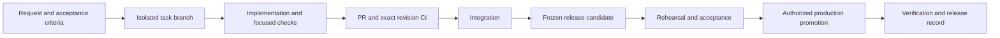

# Development workflow for people and agents

This is a proposed common workflow for features, fixes, dependency updates and
releases. The owner raised inconsistent task/branch/release practices on 17 October.
Existing [AGENTS.md](../../AGENTS.md), domain rules and specific release runbooks
remain authoritative. This proposal does not activate GitHub protection, change
the default branch, grant new production/data permissions or undo existing approvals.

## Current position and intended result

Rokkad already has domain safeguards, isolated tests, CI groups, migration/runtime
role separation and detailed release evidence. What is missing is a concise common
path from an incoming request to a reviewed change and a known production artifact.
The [dependency audit](python-dependency-audit-20261017.md) is currently local work,
including tooling/CI edits; those new gates are not enforced remotely until committed,
pushed and successfully run. This guide also remains proposed until adopted.

The maintained integration branch is currently `work/loan-servicing-contract-ld01`.
`main` is a historical remote default, not the assumed current development source.
[Status](../STATUS.md) records the verified production commit/image separately.
Do not change either fact by convention alone. A later transition to a protected
`main` should explicitly reconcile histories, CI targets, open work and release refs.

The proposed normal path is:

Implementation complete, merged and deployed are separate states. A PR can be ready
without being selected for production. A production release may combine several
reviewed changes, but its contents and compatibility boundary must be explicit.

## Canonical-main transition preflight (17 October, proposed)

GitHub still selects main. At cleanup revision `693031a7`, origin/main points to
`84653457` (20 February 2024), with zero unique commits and 709 commits on the
maintained branch. The issue is the stale default baseline, not the name main.
Prefer retaining main and advancing it to a verified integration tree, rather
than making a long-lived task branch name the permanent default.

Changing a default/pointer does not merge, rebase or delete other branches, alter
existing local upstream settings, or represent a customer Workspace/data migration.
Origin/dea-kiss is already an ancestor of maintained history; only its redundant
local name was pruned. Origin/tenants_workspace has one unique commit and rls has
76; both remain preserved. Commit uniqueness alone does not prove a missing
feature: review applicability to today's architecture before transplanting old code.
Dirty feature worktrees and checkpoint/release refs remain independent.

Before advancing main: verify the exact candidate's CI, preserve the original tip
(already in the restore-verified cleanup bundle), inspect remote rules/protection,
open PR targets and all main-triggered automation, and reconcile active work.
An ordinary fast-forward is possible from the checked ancestor; respect any PR
requirement and test the resulting merge revision if that changes its identity.
Never force-push or bypass protection to achieve the transition. Keep the old
integration ref through the handover, update guidance, and verify fresh clone/PR/CI
behavior. Production promotion remains a separately authorized immutable-image
release. No default, main pointer or protection setting is changed by this proposal.

## 1. Start with a bounded task

Read Memory, Status and the relevant contracts/domain guides in the existing order.
Inspect Git branch/commit, worktree status, relevant code/tests and known failures.
Record the requested behavior, acceptance criteria, scope, dependencies and planned
validation in the PR or an existing plan/implementation record. Use a short record
for small fixes; financial/data/migration/release work needs more explicit evidence.
Do not create a separate document for every tiny edit or invent approval ceremonies.

Clarify only missing facts that affect correctness, business authority or material
scope. Implement routine authorized work without asking again for established
permissions. Preserve the owner's current task and any standing constraints.

Acceptance should describe an observable result. For example: borrower autocomplete
supports typing, excludes the current Party and respects Workspace permissions.
"Code updated" alone is not an acceptance criterion.

## 2. Isolate the change

Use one short-lived task branch per coherent change, based on the selected committed
integration revision. Suggested names are `feat/<topic>`, `fix/<topic>`,
`deps/<package-or-group>` and `docs/<topic>`; names do not establish authority.
Use a separate worktree when another task has dirty/unmerged work. A clean dedicated
checkout is sufficient for a single task. [Git worktrees](https://git-scm.com/docs/git-worktree)
provide separate working directories/indexes while sharing repository history.

Inspect existing worktrees before allocating one. Keep each task's environment,
test database and local review port separate; worktrees alone do not isolate those
resources. Do not overwrite `.env`, silently switch a running review server's source,
or run concurrent tests against the same PostgreSQL database.

Do not use broad reset/clean/stash commands to make unrelated work disappear.
If the task depends on uncommitted work, name that dependency and preserve its
checkpoint/diff explicitly before choosing the base. Do not copy an unexplained
dirty repository into a release image. Retain recovery/customer material regardless
of Git-ignore status; use the existing retention rules for later cleanup.

## 3. Implement and validate locally

Choose the smallest coherent change. Keep business writes in existing owning
services/commands and preserve immutable accounting/custody/tenant contracts.
Avoid combining a feature, unrelated dependency upgrades and broad reformatting.
Record incidental fixes that are necessary for a gate; defer independent work.

Use the project Python version and locked dependencies. Use the pinned project-local
tools, not whichever global executable happens to be first on PATH. See
[Contributing](../../CONTRIBUTING.md), [dependency policy](dependency-policy.md) and
[testing/migrations](testing-and-migrations.md) for commands and database-role rules.

| Change | Required evidence at the relevant stage |
| --- | --- |
| Documentation only | Local links/archive preservation and scoped whitespace checks |
| UI/forms/JavaScript | Relevant interaction/render tests; browser review at affected screen sizes |
| Ordinary bug fix | Reproduce the issue, add a regression check where meaningful, run affected tests |
| Financial/lifecycle/authorization/tenant change | Applicable boundary, replay, concurrency, immutability and restricted-role RLS tests |
| Migration | Drift/graph checks, fresh schema and upgrade rehearsal; ownership/RLS coverage where applicable |
| Runtime dependency | Clean install, lock/installed consistency, current advisory scan and consumer compatibility tests |
| Production release | Exact revision CI/image, rehearsal, recovery/backup and operator acceptance required by the release runbook |

Local checks are proportional to the change. Before merging a code/runtime change,
the existing six-group CI plus quality gate must pass for the reviewed revision.
Documentation-only validation may be bounded, with the reason stated. Do not claim
tests passed because an earlier revision or unrelated candidate passed them.

For a failing check, identify whether it was introduced or reproduces on the base.
Fix the regression; repair a faulty fixture when justified; otherwise record the
remaining limitation. Do not hide a failure by skipping a test or reporting an
overlapping sum as one complete passing suite. Broaden/repeat tests when changes or
unresolved failures justify it, rather than rerunning every suite after every edit.

## 4. Review and integrate

Prepare scoped commits and a PR into the maintained integration branch. The PR
states the problem/result, acceptance evidence, tests, migrations/dependencies,
release compatibility and material limits. Review the final diff for unrelated work,
secrets/generated files, domain-boundary violations and stale documentation.

Require passing checks for the exact PR revision and current target base before
merging code/runtime changes. Target-branch updates or conflict resolutions must
receive the affected checks; use up-to-date checks/merge-queue policy when configured.
Keep the integration branch deployable; longer features need coherent independently
valid slices or existing reviewed activation gates, rather than broken intermediate
behavior. Do not introduce a new feature-flag framework merely for this process.

Recommended GitHub enforcement is a protected integration branch with required
status checks and PR review, and no routine direct pushes. GitHub supports
[required reviews/status checks](https://docs.github.com/en/repositories/configuring-branches-and-merges-in-your-repository/managing-protected-branches/about-protected-branches).
Inspect the actual repository settings before claiming enforcement exists. If owner
review is required by the adopted policy, prepare the complete PR first and make
that review the final decision, rather than repeatedly requesting permission to code.
Existing task authorization still determines who may merge/publish.

## 5. Freeze and promote a release

Select an explicit integration commit and included PRs; a release branch is optional
when stabilization requires it. Build from clean committed source. Record the commit,
image digest, requirements, migration/runtime-contract versions and coordinated
web/worker/scheduled-reader compatibility. Build once and promote the same image
digest through rehearsal and production; a rebuild is a new candidate requiring
verification. There should be no routine last-minute source overlays on the server.

Use the existing [container/CI guide](container-and-ci.md),
[deployment runbook](linode-production-cutover.md) and current release-specific
evidence. Prepare static/media/config compatibility, scoped operator acceptance,
recovery verification, pre/post backups and a concrete deployment plan. Rehearse
fresh/upgrade paths and preserved business evidence when the change requires it.
Keep production-copy data and private keys in their authorized locations.

Honor existing production authorization. A request to implement a fix does not by
itself grant a new financial repair, provider activation or unrelated deployment.
When release approval is required, present the tested image and exact change/schema/
recovery plan after preparation is complete. Do not invent additional approvals
already satisfied by standing authorization.

Deploy compatible readers together, run owner-only migrations at the selected
boundary and keep runtime roles restricted. A previous writer is not automatically
safe after a schema/contract transition. Prefer the reviewed forward-recovery path
where rollback would be incompatible; never restore over later customer activity
without its separate explicit recovery plan/authority.

Verify live health, selected read-only business journeys, workers/timers, runtime
identity, compatible schema and backups/recovery. Record the deployed digest/commit,
outcome and limitations in Status and the release record. "Container started" alone
does not mean production verification is complete.

## 6. Keep dependency upgrades separate and executable

"Pending compatibility testing" means an available version has not passed the
application checks needed to adopt it. It should become tracked work with a package
group, target versions, owner/source record, test plan and outcome or defer reason.
It must not become a vague permanent promise.

| Upgrade group | Examples of acceptance checks |
| --- | --- |
| Django/allauth | Startup, login/Google-token tests, forms, permissions, RLS and migration checks |
| ReportLab/PyMuPDF/Pillow | Document layouts, overlays, QR/image previews and retained source/reprint invariants |
| Redis/django-redis | Actual backend connectivity, TTL/serialization, unavailable-cache behavior and Workspace-sensitive search |
| import-export/Tablib/openpyxl | Required format availability, spreadsheet round-trips and source/import limits |
| Gunicorn/WhiteNoise | Clean Linux image startup, static collection/manifest, proxy/runtime-role checks |

A major version can break interfaces, configuration or output; a patch can also
regress behavior. Test based on the actual change, not just the version label.
Security patches receive priority. Regenerate matching locks and install into an
isolated environment, review consumer behavior, then merge/release using the same
workflow. Never freeze leftover developer packages into runtime requirements.

## 7. Handle production fixes and data repairs explicitly

For an urgent production bug, start from the verified deployed source revision,
not a branch containing unrelated unreleased features. Reproduce it with synthetic
data or an authorized isolated copy, keep the hotfix bounded and run applicable
checks/recovery gates. Record which urgency-based test reductions were made and
which validation remains. Urgency does not waive financial/RLS/recovery invariants.

After promotion, reconcile the hotfix into integration and any active release
candidate so a later deployment cannot reintroduce it. Revalidate affected merges.

A production data repair is distinct from deploying its code fix. Prefer a scoped,
idempotent command with a default preview, exact source/target evidence, actor and
Workspace boundaries, audit records, backup/recovery and post-repair verification.
Apply only the authorized selection; code-deployment approval is not blanket data
mutation permission. Use the relevant existing domain repair contract.

## Completion and adoption

Agents should report the final behavior, tested revision, validation and limits,
PR/merge identity where applicable, deployment state and any remaining tracked work.
Update Status for delivery, Memory for durable rules and the relevant domain/flow/
implementation records. Commit only the task's coherent work. Retire clean merged
task branches/worktrees through verified retention, preserving unmerged/dirty work.

Proposed adoption sequence:

1. Review this guide and establish the owner/reviewer and release-authorization policy.
2. Finish the pending dependency/tooling change as its own reviewed PR; run exact
   revision Linux CI and record whether it is merged/released.
3. Add a concise accepted-workflow requirement to AGENTS.md, keep the practical
   guide here and put reusable review prompts in a PR template.
4. Inspect/configure actual GitHub branch checks/reviews and release protections
   for the current integration branch. This document alone cannot enforce them.
5. Plan the separate historical-main transition if desired. Do not move defaults
   or rewrite/delete references as an incidental workflow cleanup.

The guide is deliberately small in machinery: Git branches/worktrees, existing
requirements/tools, current Django tests/CI, PRs and the existing release runbooks.
Further automation should follow repeated, demonstrated needs.
