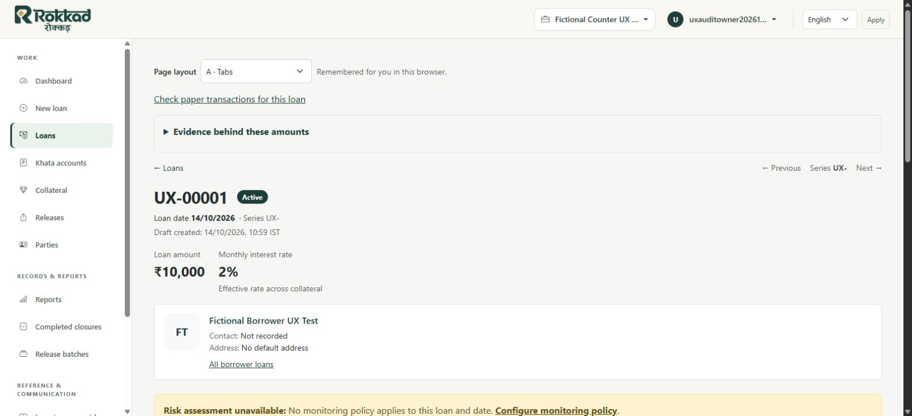
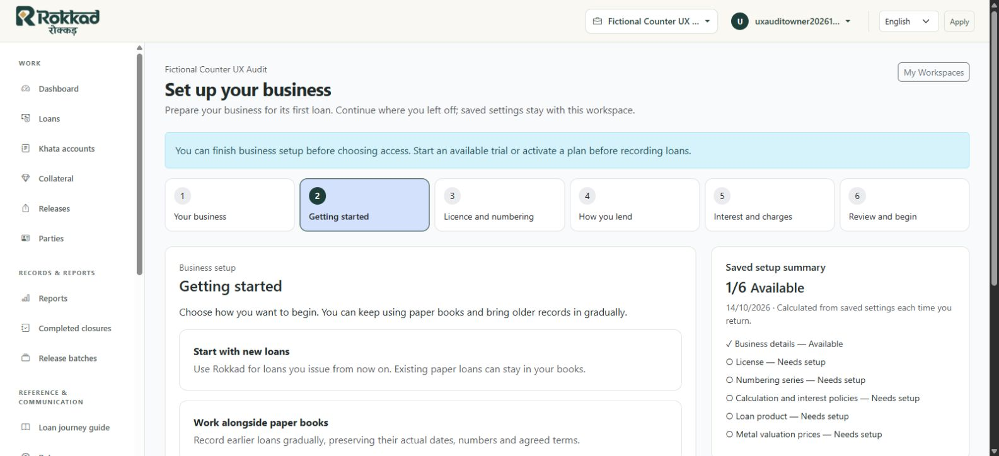
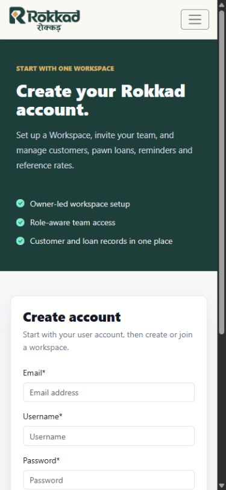
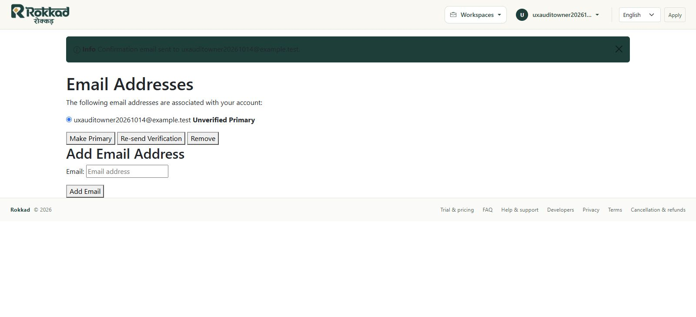

# New visitor to first active loan: experience audit

The owner subsequently approved the recommended corrections. See the
[completed local refinement](new-user-journey-refinement-20261014.md) and
[NJ-01 through NJ-05 plan](../plans/new-user-journey-improvements-20261014.md).
This audit retains the original before-change findings.

## Outcome and scope

The current checkout can take a new owner from account creation into a new
business and its first ordinary active pawn loan. The remaining problems are
inconsistent public information, authentication guidance, activation handoffs and
setup presentation. The underlying loan lifecycle does not need replacement.

This is an audit and proposed improvement order, **not an implemented redesign
or production onboarding acceptance**. No application source, schema, production
records or existing development data were changed for this work.

Live Chrome checks covered pricing, FAQ and their contact link on rokkad.com.
The production browser was already signed in; its existing account was kept
intact. Anonymous discovery and all account/business/loan writes used the current
local checkout at loopback port 8112 and a newly migrated, empty database,
`rokkad_onboarding_ux_audit_20261014`. No production or development data was copied.
The owner approved creating this disposable database and granting the existing
restricted runtime role access to it alone. Runtime role flags were checked:
neither superuser nor RLS bypass. The role itself was not altered.

Mail was captured in memory, storage was local to the audit folder, external
payment/OAuth facilities were disabled and no delivery worker ran. Signup, email
confirmation, trial acceptance, licence/series submission, approval and payout
were exercised through Django's actual HTTP views with fictional test data.
These are software test submissions, not real contracts or payments. Browser
checks exercised ordinary signin, business creation, product activation,
standing calculation-policy entry, source/quote creation, customer creation,
amount preview, draft save and monitoring-policy creation. Final user actions
were verified on the resulting screens.

External inbox delivery, Google signin, physical printing, actual staff usability,
arbitrary imports and a complete paper-loan backlog were not tested. Current
local behavior must be checked against the chosen production release before a
fix is deployed; local authentication failures are not asserted as measured
production authentication failures.

## Journey exercised

| Stage | Observed outcome |
| --- | --- |
| Discover the product | Pawn lending, borrower records, pledged jewellery, collections and returns are clear; trial and pricing are reachable from the public header. |
| Decide whether to try it | Live pricing/FAQ explain 30 days, owner plus five staff, no card, no automatic charge, one trial per owner and grace/read-only behavior. Paid continuation is explicitly unavailable rather than silently promised. |
| Ask for assistance | Live FAQ → Talk to us redirects the signed-in owner to the Workspace chooser. Anonymous local Talk to us redirects to signin. The contact destination is therefore not functioning as public assistance. |
| Create an account | Signup asks for email, username and password. Invalid email/short passwords show field errors. A valid test signup captures one verification message and signs the user in to an empty Workspace chooser, still unverified. Creating the account does not start the trial. |
| Sign in | The local form labels the identifier Username. The correct fixture email/password is rejected; the same password with the username succeeds. Password-reset request captures a message and reaches its confirmation screen. |
| Create a business | Only business name is mandatory; logo and colour are optional. The successful save opens guided setup directly, on Getting started. |
| Verify and activate | Account settings → Email Addresses offers resend verification. Actual confirmation GET/POST succeeds. Starting a trial while unverified is rejected without creating a subscription. Once verified and accepted, the test trial starts and redirects to the business dashboard. |
| Configure lending | Licence/evidence and series saves return to the guided journey. Four prepared product drafts are visible; enabling flexible repayment updates saved readiness. Interest/tenure save and quote save return to the terms step. |
| Review setup | A gold-only configuration with one usable gold quote shows 6/6 Available. Saved numbering previews and a worked payout/closing example are useful. No monitoring policy has been created at this point. |
| Add the first borrower | Create your first loan first opens a clear missing-customer gate, using the technical term Party. Customer creation opens the borrower record, which has Start loan for this customer. That link preserves the borrower selection. |
| Create the loan | The sole series/product and standing tenure are automatically selected. Collateral principal, value and LTV guidance work. Amount preview creates no loan; saving the draft issues UX-00001. |
| Make it active | Ordinary HTTP approval and payout succeed; the active screen shows principal and the next servicing actions. It also reports that risk assessment is unavailable because no monitoring policy applies. |
| Establish monitoring | The repair link opens monitoring setup. Saving a reviewed fictional policy removes the missing-policy warning. The live selector returns STANDARD, LOW severity and no flags for the test loan. No scheduled assessment worker was run. |
| Return later | Authenticated home resolves to the saved business dashboard. All six guided setup screens, the Loans list and New loan return 200. Saved next-loan preview is UX-00002, with the separate release counter unchanged. |

The sole synthetic loan used 14 October 2026, 12 months, ₹10,000 principal,
2% monthly interest, one month upfront, no document fee and ₹9,800 payout. Its
single fictional gold item was 3 g at 90% purity, with a fictional ₹10,000/g
pure-metal buying quote and ₹27,000 appraisal. Lower-of valuation and the 80%
limit therefore supported the entered principal. These values are test facts,
not suggested commercial rates or licensing evidence.

## Prioritized findings

### NU-01 — Repair public contact routing and content (high)

This is a reproduced navigation defect. The public CTA cannot reliably get a
prospective customer to support. The current middleware still classifies
`/contact/` among Workspace-required prefixes. The contact template also contains
old ERP language about sales, purchases and accounting, and placeholder email
instructions instead of a direct support action. The footer's support mail link
works as an alternative; no email was sent during this audit.

Use the exact public contact route as a public page, while preserving isolation
for genuine Workspace endpoints. Give it the existing support address and
current pawn-lending setup/help copy. Verify anonymous and authenticated access;
do not relax tenant authorization through a broad prefix exception.

Sources: [middleware](../../apps/orgs/middleware_v2.py),
[contact page](../../templates/pages/contact.html),
[FAQ](../../templates/pages/faq.html).

### NU-02 — Align signup, signin and verification language (high)

The installed local allauth configuration uses username login. Base settings
declare singular `ACCOUNT_LOGIN_METHOD`, while the installed library reads
`ACCOUNT_LOGIN_METHODS`; the configured email intention is not reaching the
actual login form. Email is required for verification, but username is required
to sign in. Public references to a sign-in email make this especially confusing.

Choose and test a deliberate login contract. A small compatibility-preserving
first change could support email and existing usernames, with a correctly
labelled identifier field; removing the signup username requirement is a separate
decision. Preserve existing accounts, invitations, verification, password-reset
and next-destination behavior. Check the deployment's installed version/settings
before applying a library-specific fix.

Sources: [base settings](../../django_project/settings/base.py),
[signup](../../templates/account/signup.html),
[signin](../../templates/account/login.html).

### NU-03 — Make verification and trial activation part of the guided handoff (high)

Signup produces a verification email but lands on My Workspaces without a visible
verification task. An unverified owner can create/configure the business, which
is useful, but the trial page offers a start button before explaining this
prerequisite. Failed activation shows text, without a contextual verification
or resend action. Reaching resend requires account settings and another screen.

The activation page begins with general subscriptions/support and recurring
payment links, although the user's immediate task is to begin the free trial.
Successful activation redirects to the dashboard rather than the setup step the
owner left. Public FAQ describes verification → business → trial → setup;
the actual journey permits business/setup first. Both orders are valid, but the
interface should explain and support them consistently.

Show verified/unverified status and direct verification/resend actions where
needed. Lead a first-time owner with the available trial and its exact terms.
After confirmation/activation, offer a safe return to that owner's same business
setup. Keep consent explicit; account/business creation must not silently consume
the trial. Do not add a second onboarding state machine.

Sources: [trial contract](../../apps/subscriptions/public_trial.py),
[trial views](../../apps/subscriptions/views.py),
[business setup](../../templates/company/workspace_setup.html),
[Workspace chooser](../../templates/company/workspace_home.html).

### NU-04 — Distinguish lending readiness from monitoring readiness (high)

The setup's six saved checks allow a first loan while monitoring remains
unconfigured. This is an actual tested sequence: 6/6 Available → first active
loan → no applicable monitoring policy. The availability calculation is truthful
for its six checks, but it is easy to read as business setup complete.

Keep lending authority and monitoring configuration separate. Make monitoring
readiness visible in the guided terms/review screens, with an explicit review
and save action. Show incomplete monitoring clearly before the first loan; do
not silently adopt thresholds or block lawful recording merely to make a badge
green. Explain that current per-loan calculation and saved portfolio assessment
freshness are also distinct. Worker provisioning remains an operational concern.

Sources: [guided setup](../../templates/company/workspace_setup.html),
[economic setup](../../templates/loans/setup/economics.html),
[live assessment](../../apps/tenant_apps/loans/selectors/risk.py),
[monitoring reference](../architecture/post-origination-loan-monitoring.md).

### NU-05 — Reduce first-time navigation and terminology load (medium)

The empty account shows three zero-count statistics, account overview, archived
Workspaces and repeated create actions before a business exists. Business setup
then exposes the full operational/sidebar settings menu. The six-step journey
is clear, but its links open screens that also contain a second loan-setup
navigation strip. This gives a new owner several competing definitions of setup.

Use a focused first-business empty state, preserving an invitation path. Explain
Workspace once as the separate space for a business. Use customer/borrower in
counter-facing gates rather than Party, and ordinary loan rather than PawnLoan
where a technical entity name adds no value. Show one contextual setup navigation
while guided entry is active; retain ordinary administration routes for later.
Keep the derived saved-check selector authoritative and the manually dismissible
general checklist clearly secondary.

Sources: [chooser](../../templates/company/workspace_home.html),
[guided setup](../../templates/company/workspace_setup.html),
[first-loan gate](../../templates/loans/pawn/blocked.html).

### NU-06 — Make consequential setup choices explicit and understandable (medium)

A new fictional business defaults to separate approval and payout. Its new-loan
form therefore leads with Save draft, with later approval/payment actions. The
combined owner workflow exists, but choosing it is another link from How you
lend. Product drafts are usefully prepared, yet version tables show technical
repayment/calculation terms alongside the business choices.

Offer a clear owner-operated versus separate-review workflow choice in the
existing lending step. Explain what changes at the counter without changing an
existing business's selection. Retain reviewed product activation. In the terms
step, collateral valuation and maximum lending percentage should be clear basic
decisions; the current guided form groups them with rounding in a collapsed
advanced section. Keep actual rounding/compound details available and preserve
their validation. Highlight the effective date's significance for older paper
records rather than silently backdating policies.

Sources: [lending step](../../templates/company/workspace_setup.html),
[product page](../../templates/loans/setup/products/list.html),
[economic form](../../templates/loans/setup/economics.html),
[ordinary entry](../../templates/loans/pawn/routine_entry.html).

### NU-07 — Keep the primary action reachable on phones (medium)

At a 390×844 viewport, trial, signup and setup review fit without document-level
horizontal overflow. The signup email control begins about 659 px down because
the full marketing panel precedes it. The completed setup review's Create a loan
action begins about 2,996 px down, after the settings summary and worked example.

Keep a concise product introduction and put the signup task early on small
screens. Move the primary first-loan action near the readiness summary, retaining
the full review below and making the worked example an optional learning aid.
This must not bypass the actual loan review. Retest keyboard focus, errors and
small-screen links after any layout change.

### NU-08 — Finish the supporting account screens (medium)

Email management uses default unstyled controls and a generic Multi-Tenant SaaS
page title, unlike the polished signup/signin layout. Its confirmation banner
has difficult-to-read dark text against a dark background in the test business.
Verification is a required handoff for trials, so this screen affects trust and
completion. Apply existing form/layout patterns to verification, reset and their
confirmation screens, and check message contrast across supported brand colours.
Avoid new UI frameworks.

### NU-09 — Bring public capability statements up to date (medium)

The landing page describes paper transition mainly as recording batch closures
and calls guided Excel import planned. Ordinary paper-loan recording and a
bounded supported register-import flow already exist. Getting started also says
each loan asks its entry purpose, although ordinary entry now inherits standing
setup and exposes an optional override. Align public and guided copy with the
released capabilities. Keep broader pending portability work and unsupported
source formats explicitly bounded.

Sources: [landing page](../../templates/pages/home.html),
[guided setup](../../templates/company/workspace_setup.html),
[register guide](../flows/guided-outstanding-register-import.md),
[entry presentation](../../templates/loans/pawn/_entry_override.html).

## Recommended delivery order

1. **Repair discovery and authentication:** NU-01 and NU-02, with production
   version checks, public-route isolation tests and existing-login compatibility.
2. **Connect verification, business and trial:** NU-03 and NU-08; retain explicit
   consent and safe Workspace ownership/return routing. Finish with a controlled
   verification-email delivery check to an approved test recipient.
3. **Clarify readiness and choices:** NU-04 and NU-06; keep existing calculation,
   license/series, product, numbering and loan validation services authoritative.
4. **Refine the presentation:** NU-05, NU-07 and NU-09; preserve invitation access,
   existing staff navigation and the supported paper/import boundaries.
5. **Repeat owner acceptance from an empty business:** test both direct lending
   and paper-first setup, stop/resume, verification resend and first-loan
   monitoring on desktop and phone. Keep synthetic tests distinct from real
   owner/staff acceptance and provider delivery acceptance.

These are proposed slices awaiting selection, not a new approved release plan.
Reuse the current guided journey and services. No new financial domain, wizard
framework or parallel setup-completion model is justified by the findings.

## Evidence and cleanup

Private task scripts/results are under `.tmp/onboarding-ux-audit-20261014/`;
screenshots retained here contain only fictional local data. HTTP results cover
signup field errors, optional verification, trial gating/activation, licence and
series saves, actual approval/payout, all six setup routes, loan create/list,
returning-owner routing, password-reset capture and the live risk result.

The audit server and exact disposable database are removed at completion.
Existing local servers, role attributes, shared development data and production
accounts/businesses/loans remain intact. No commit, push or deployment is implied
by this review.
