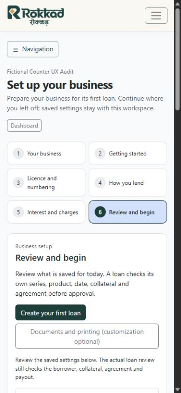

# New-user journey refinement

Later software delivery is complete in the [15 October combined release](reviewed-production-release-20261015.md). This dated note retains its local implementation evidence.

The owner approved implementing the [journey audit's recommendations](new-user-journey-audit-20261014.md)
in the existing workflow. NJ-01 through NJ-05 are implemented and verified locally.
No production deployment or commit is part of this request. Preexisting checkout
changes are preserved; this increment introduces no model, migration or new wizard.

## What changes for a user

Public support is reachable at the exact `/contact/` route without a Workspace.
Both the Workspace middleware and the retired Contact URL adapter needed a narrow
exception. Scoped Contact bookmarks still redirect to Party, mapped-domain access
still resolves its Workspace, and neighboring retired routes remain scoped.

Existing accounts sign in with email or their existing username. The pinned
django-allauth 65.19.4 setting is `ACCOUNT_LOGIN_METHODS`, replacing the unsupported
singular setting. Signup still retains usernames. Login/signup preserve allauth's
validated redirect field, including invitation continuation; no account is renamed.

An empty My Workspaces page explains the first business action instead of showing
zero account metrics. Verification is a visible task on that page and guided setup.
The email manager, confirmation, verification-sent and reset screens share a readable
account-task layout, feedback and continuing links. Resend uses the existing allauth
and platform mail paths. Message colors now use alert levels: toast-only CSS tag
classes had produced low-contrast feedback when reused as alert classes.

Trial activation shows verification first and then the existing explicit consent
form. Starting a trial returns to the validated guided step or owned business setup;
the older incomplete team-onboarding continuation remains supported. Email verification
remembers only validated user/Workspace IDs in the session and rechecks active
ownership and membership. Anonymous confirmation returns through sign-in. Requested
URLs never grant Workspace access, alter preference or become arbitrary redirects.

The six setup steps stay unchanged. Guided pages use focused setup navigation;
the full permission-filtered menu remains available in a disclosure. Ordinary
counter screens keep their normal menu. Owners can explicitly save either existing
payout workflow in How you lend. The choice does not silently change on first visit.
Collateral valuation and LTV remain visible in economic setup; part-month,
compound and rounding fields are advanced sections with the same values/validation.
Earlier-loan guidance explains actual policy dates and that a setup path does not
change standing entry purpose.

Setup reports monitoring availability independently of the six lending checks.
The selector resolves today's existing Workspace/default or licence-specific policy
for each running usable series, sharing lookups for a licence. It creates nothing
and performs no loan assessment. A configured policy is not evidence completeness,
fresh portfolio coverage, lending permission or approval of a particular loan.
Review and begin places its first action and monitoring card before the detailed
terms. The optional worked example is collapsed unless explicitly requested.
Public copy describes currently supported paper recording and bounded register
imports. New journey guidance has Hindi translations; existing mixed-language
public copy is not claimed to be fully translated.

## Verification and limits

All 340 distinct selected checks are verified: 339 passed in the broad run; an
existing route-order test assumed canonical groups started before two already
present public paid-entry routes. Its expectation now explicitly preserves both
routes and contiguous canonical groups. All 16 route-intent tests pass on rerun.
The 70 focused checks overlap this set. The suites cover restricted-role account
and setup access, CSRF-supported forms, email/username compatibility and invalid
credentials, safe returns, trial refusal/replay, invitations, mail hooks, scoped
monitoring readiness, series availability, standing policies, quote limits,
direct/combined payout and independent/multiple-item paper origination.

The authorized local audit database used Rokkad's existing restricted runtime
role, verified with neither superuser nor RLS-bypass flags. A separate disposable
test database held fictional fixtures. Mail was captured in memory, external
payment/OAuth disabled, media stored in the ignored task directory and the audit
server bound to loopback port 8112. Development and production records were not
copied or changed. Test global role fixtures were reseeded only in the exact
disposable test database after TransactionTestCase flushes; no runtime seed logic
was changed.

Actual HTTP signup/confirmation/trial and licence/series uploads combine with
Chromium email signin, business creation, workflow/product/policy/quote setup,
customer creation and first draft/review. The fictional UX-00001 becomes active
through the existing owner combined review/payout HTTP route: INR 10,000 principal,
2% monthly, 12 months, INR 200 upfront interest and INR 9,800 net payout. The existing
read-only risk calculation returns STANDARD/LOW with no flags. Browser paper entry
on 24 September resolves the dated standing terms and reaches a separate review:
INR 3,000 principal, INR 60 advance interest, INR 2,940 original proceeds, 12 months.
It retains original numbers and advances no counter at review. That review is not
submitted as a second financial record in the walkthrough; paper recording/service
behavior is covered by the regression suites.

Phone checks at 390 x 844 show the signup email field at approximately 491px;
the first-loan action is at approximately 654px in English and 641px in Hindi.
Neither page has horizontal overflow. The review example stays collapsed, monitoring
changes from explicit Needs attention to Policy configured only after staff saves
the policy, and ordinary loan screens retain full navigation. Viewport overrides
are reset. Screenshots use only fictional data.

Other checkpoints: [first business](assets/new-user-journey-refinement-20261014/first-business.jpg),
[phone signup](assets/new-user-journey-refinement-20261014/signup-mobile.jpg),
[desktop review](assets/new-user-journey-refinement-20261014/review-desktop.jpg),
[Hindi phone review](assets/new-user-journey-refinement-20261014/review-hindi-mobile.jpg),
[paper review](assets/new-user-journey-refinement-20261014/paper-review.jpg).

Ignored local helpers/logs are in `.tmp/onboarding-journey-implementation-20261014`
and `.tmp/onboarding-ux-audit-20261014`. Django system/template checks, migration
drift check, supported-app boundary check, current documentation links, translation
compilation and whitespace checks accompany the regression evidence. The exact
disposable databases and audit server are removed after acceptance; existing
local review services remain unchanged.

Production release, actual mail-provider inbox/link delivery and real owner/staff
acceptance remain separate. These checks reduce regression risk; they cannot
establish that every deployed environment or mail client behaves identically.

## Owner local review

At the owner's request, the exact isolated audit database was recreated from an
empty schema after the acceptance cleanup. The current checkout is served at
`http://127.0.0.1:8112/` with a verified fictional account and no business yet,
so the owner can review first-business setup. Its temporary credentials are shared
directly with the owner, not stored in repository documentation. Mail stays local,
payment/OAuth providers remain disabled, and uploads use isolated local storage.
This preview is intentionally left running for review; remove the exact database
and server after the owner finishes. Port 8000 retains the older review snapshot;
development and production remain untouched.
